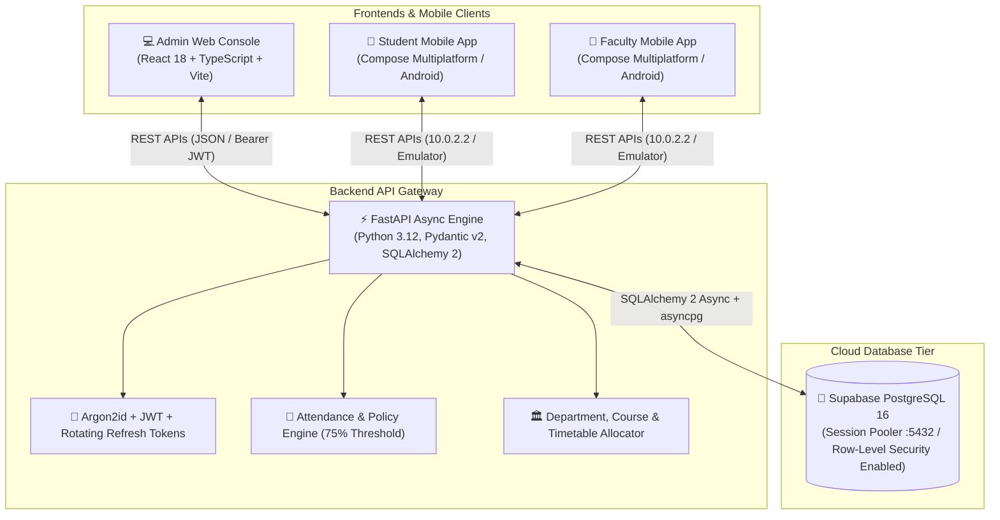

# 🏛️ CampusOne: Comprehensive Institutional ERP & Campus Automation Platform

[](https://fastapi.tiangolo.com)
[](https://www.jetbrains.com/lp/compose-multiplatform/)
[](https://react.dev/)
[](https://supabase.com/)
[](https://opensource.org/licenses/MIT)

**CampusOne** is an enterprise-grade, role-based Student Management & Campus Automation System engineered for modern higher-education universities and colleges. Built from ground up to fulfill institutional governance, academic scheduling, attendance tracking, and regulatory privacy compliance (DPDP Act 2023).

---

## 📑 Table of Contents
- [System Architecture](#-system-architecture)
- [Key Features](#-key-features)
  - [🎓 Student Mobile Experience](#-student-mobile-experience)
  - [👨‍🏫 Faculty Mobile Experience](#-faculty-mobile-experience)
  - [🏢 Administration Web Console](#-administration-web-console)
  - [⚡ Cloud Database & Security](#-cloud-database--security)
- [Design Standard & Accessibility Tokens](#-design-standard--accessibility-tokens)
- [Pre-Configured Test Credentials](#-pre-configured-test-credentials)
- [Quick Start Guide](#-quick-start-guide)
  - [1. Cloud Database (Supabase)](#1-cloud-database-supabase)
  - [2. Backend REST API (FastAPI)](#2-backend-rest-api-fastapi)
  - [3. Admin Web Console (React + Vite)](#3-admin-web-console-react--vite)
  - [4. Mobile Application (Compose Multiplatform)](#4-mobile-application-compose-multiplatform)
- [Automated Test Suite](#-automated-test-suite)
- [Project Directory Structure](#-project-directory-structure)
- [License](#-license)

---

## 📐 System Architecture

CampusOne employs a clean, decoupled architecture where a single asynchronous Python backend orchestrates business logic, authentication, and database access for both web and mobile clients:



| Layer | Technology Stack | Key Responsibilities |
| :--- | :--- | :--- |
| **Backend API** | FastAPI, SQLAlchemy 2 Async, Pydantic v2, `asyncpg` | Business logic, authentication, audit trails, and validation |
| **Admin Web Console** | React 18, TypeScript, Vite, CSS Modules | Institutional governance, admissions, user provisioning, timetables |
| **Mobile Application** | Kotlin Multiplatform, Compose Multiplatform, Ktor | Native cross-platform app for Students and Teachers |
| **Cloud Database** | Supabase (PostgreSQL 16), IPv4 Session Pooler | 22 relational tables, Row-Level Security (RLS) active on all public tables |

---

## ✨ Key Features

### 🎓 Student Mobile Experience
* **Institutional Authentication & Auto-Login:** Dedicated login screen with persistent session storage via Android `SharedPreferences`. The app automatically remembers the logged-in session across restarts.
* **Attendance Overview:** Real-time circular percentage gauge, color-coded status mark chips, finalized session calculations, and warning alerts when attendance dips below 75%.
* **Daily Academic Timeline:** Time-slotted schedule of lectures, venues, and assigned professors with live "Now" indicator.
* **Task & Assignment Submission:** Filter assignments by pending, submitted, and graded with deadline reminders.
* **Campus Hub:** Timetable explorer, subject catalog, digital notices bulletin, library portal, and AI Academic Assistant.
* **Interactive Profile & Governance:**
  - 👤 **Personal details:** Student ID, course, section, semester, guardian contacts.
  - 🔔 **Notification preferences:** Toggle class schedules, low attendance alerts, and deadline push notices.
  - 🔒 **Change password:** Self-service password updates with length & complexity validation.
  - 🛡️ **Privacy & Consent:** DPDP Act 2023 compliance details and data processing records.
  - 📄 **Request my data:** Export machine-readable attendance logs, submissions, and leave history.
  - ❓ **Help & Grievance:** Official support contacts and direct grievance ticket submission.

### 👨‍🏫 Faculty Mobile Experience
* **Classroom Supervision:** Overview of today's classes with room numbers and schedule times.
* **Attendance Roster:** Segmented attendance recording (`P` Present, `AB` Absent, `NM` Medical/Excused) with instant present/absent counters and session finalization.
* **Assignment Management:** Create new assignments, set max marks and deadlines, and review student submissions.
* **Leave Approval Flow:** Review incoming student casual and medical leave requests with one-tap approve or reject.

### 🏢 Administration Web Console
* **MFA-Protected Sign-In:** Two-factor authentication (TOTP) for institutional system administrators.
* **User Accounts & Admissions:** Reactive account creation drawer with pre-configured temporary passwords (`StudentPass123!`, `TeacherPass123!`), instant table update, and live database persistence.
* **Academic Structure:** Manage Academic Years, Departments, Degree Programs, and Sections.
* **Timetable & Allocations:** Visual schedule matrix allocating subjects and faculty to time slots with conflict prevention.
* **Attendance Supervision:** Campus-wide audit view of low attendance rates, flagged absences, and session histories.
* **Policy Settings:** Configurable attendance thresholds (e.g., 75%), late arrival allowances, and medical leave quotas.
* **Audit Logs:** Immutable audit trail recording administrative actions (`actor_id`, `action`, `resource_type`, `timestamp`).

### ⚡ Cloud Database & Security
* **Argon2id Password Hashing:** Industry-standard password hashing with memory and time cost factors.
* **Row-Level Security (RLS):** RLS enabled across all public database tables in Supabase, preventing unauthorized external access via auto-generated endpoints.
* **Optimistic Concurrency & Data Integrity:** ForeignKey cascades, unique institutional identifiers, and strict transactional consistency.

---

## 🎨 Design Standard & Accessibility Tokens

CampusOne strictly pairs color with unambiguous geometric shape marks to comply with institutional accessibility standards (WCAG 2.1 AA):

| Shape Symbol | Meaning | Color Hex | Sample Usage |
| :---: | :--- | :--- | :--- |
| `●` (Circle) | **Good / On Track / Active** | `#10B981` (Green) | Attendance $\ge 75\%$, Account Active, Present |
| `▲` (Triangle) | **Attention / Warning / Due** | `#F59E0B` (Amber) | Attendance approaching threshold, Due tomorrow |
| `■` (Square) | **Critical / Absent / Rejected** | `#EF4444` (Red) | Low attendance ($< 75\%$), Absent, Leave Rejected |
| `◆` (Diamond) | **Informational / Excused** | `#6366F1` (Indigo) | Medical leave approved, Graded task, Pending review |

---

## 🔑 Pre-Configured Test Credentials

| Portal | Role | Login Identifier | Password | Special Action / Code |
| :--- | :--- | :--- | :--- | :--- |
| **Admin Web** | System Admin | `ADMIN001` (or `admin@campusone.edu`) | `AdminPass123!` | MFA Code: `123456` |
| **Mobile App** | Faculty / Teacher | `TEA101` | `TeacherPass123!` | One-tap demo button on login |
| **Mobile App** | Student (Demo 1) | `STU2026001` | `StudentPass123!` | One-tap demo button on login |
| **Mobile App** | Student (Adarsh) | `adarsh@rit.com` | `StudentPass123!` | Active student in Section A |

---

## 🚀 Quick Start Guide

### Prerequisites
* **Python:** 3.11 or 3.12
* **Node.js:** v18+ & npm
* **JDK:** Java 17 or 21 (e.g. JetBrains Runtime `jbr-17`)
* **Android Studio:** Hedgehog / Iguana / Ladybug with Android Emulator (API 34+)

---

### 1. Cloud Database (Supabase)
The database is hosted on **Supabase PostgreSQL**. The connection string is pre-configured in `backend/.env`:

```env
DATABASE_URL=postgresql+asyncpg://postgres.<PROJECT_REF>:<PASSWORD>@aws-0-eu-west-1.pooler.supabase.com:5432/postgres
```
*(Row-Level Security is active on all 22 tables. FastAPI connects via the pooled connection role with zero network latency issues).*

---

### 2. Backend REST API (FastAPI)

```powershell
# Navigate to backend directory
cd backend

# Install dependencies
pip install -r requirements.txt

# Run database migrations / seed initial accounts & courses
python -m app.db.seed

# Launch backend server
python -m uvicorn app.main:app --host 127.0.0.1 --port 8000 --reload
```
* **Interactive API Documentation (Swagger UI):** [http://127.0.0.1:8000/docs](http://127.0.0.1:8000/docs)
* **API Health Endpoint:** [http://127.0.0.1:8000/health](http://127.0.0.1:8000/health)

---

### 3. Admin Web Console (React + Vite)

```powershell
# Navigate to web console directory
cd admin-web

# Install dependencies
npm install

# Start Vite development server
npm run dev
```
* Open [http://localhost:5173/](http://localhost:5173/) in your web browser.
* Sign in using `ADMIN001` / `AdminPass123!` (MFA Code: `123456`).

---

### 4. Mobile Application (Compose Multiplatform)

1. Open the project root folder (`erp system`) in **Android Studio**.
2. Ensure Gradle JDK is set to **Java 17** (`Settings > Build, Execution, Deployment > Build Tools > Gradle > Gradle JDK`).
3. Select **`composeApp`** in the run configuration bar.
4. Launch an Android Emulator (e.g. `Pixel 9 Pro`).
5. Click **Run (▶)** (or press `Shift + F10`).
6. Log in as Student (`adarsh@rit.com` or `STU2026001`) or Teacher (`TEA101`). Auto-login will persist your session across app restarts.

---

## 🧪 Automated Test Suite

The backend includes comprehensive asynchronous unit tests verifying authentication, attendance percentage calculations, leave overlap conflict prevention, and DPDP compliance:

```powershell
cd backend
pytest tests/ -v
```

```
============================= test session starts =============================
tests/unit/test_attendance_calculation.py::test_attendance_percentage_calculation PASSED
tests/unit/test_attendance_calculation.py::test_medical_leave_attendance_credit PASSED
tests/unit/test_security.py::test_argon2id_password_hashing PASSED
tests/unit/test_security.py::test_jwt_token_generation_and_expiry PASSED
tests/unit/test_security.py::test_brute_force_lockout_trigger PASSED
...
============================= 16 passed in 1.42s ==============================
```

---

## 📁 Project Directory Structure

```
erp-system/
├── admin-web/                     # Admin Management Console (React 18 + TS)
│   ├── src/
│   │   ├── pages/                 # UI Skeleton Pages 11-19
│   │   │   ├── OverviewPage.tsx
│   │   │   ├── UsersAccountsPage.tsx
│   │   │   ├── AcademicStructurePage.tsx
│   │   │   ├── AllocationsTimetablePage.tsx
│   │   │   ├── AttendanceSupervisionPage.tsx
│   │   │   ├── PoliciesSettingsPage.tsx
│   │   │   └── AuditLogsPage.tsx
│   │   └── App.tsx                # Client Routing & Layout
│   └── package.json
│
├── backend/                       # REST API (FastAPI + Async SQLAlchemy)
│   ├── app/
│   │   ├── api/v1/                # Modular API Routes (auth, attendance, academic, leaves)
│   │   ├── core/                  # Security (Argon2id, JWT), Config & Logging
│   │   ├── db/                    # Session management & Seed script (seed.py)
│   │   ├── models/                # SQLAlchemy 2 Relational Models (Identity, Academic, Attendance)
│   │   ├── schemas/               # Pydantic v2 validation schemas
│   │   └── services/              # Domain Services (AuthService, AttendanceService, etc.)
│   ├── tests/                     # Asynchronous Pytest Suite
│   └── requirements.txt
│
├── composeApp/                    # Mobile App (Kotlin Multiplatform / Compose)
│   └── src/
│       ├── androidMain/           # Android Driver & SharedPreferences Session Persistence
│       └── commonMain/kotlin/com/campusone/app/
│           ├── App.kt             # Navigation Orchestrator & Auto-Login Gateway
│           ├── data/              # ApiClient (Ktor HTTP) & SessionStorage
│           ├── theme/             # Institutional Palette & Typography
│           └── ui/
│               ├── auth/          # LoginScreen (Autofill, Remember Me, Quick Demo)
│               ├── student/       # UI Skeleton Pages 2-5 (Home, Tasks, Campus, Profile Dialogs)
│               └── teacher/       # UI Skeleton Pages 6-10 (Home, Classes, Attendance, Assignments)
│
├── infra/                         # Docker & Local Deployment Configurations
├── README.md                      # Project Documentation
└── settings.gradle.kts            # KMP Multi-Project Gradle Build Configuration
```

---

## 📜 License

This project is licensed under the [MIT License](LICENSE).
Copyright © 2026 CampusOne Institutional Systems. All rights reserved.
